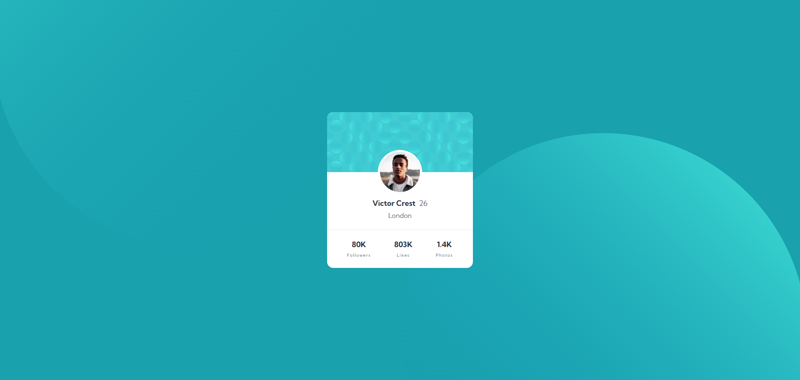

<h1 align="center">Profile card component</h1>

Solution to the Frontend Mentor challenge

  

This is a solution to the [Profile card component challenge on Frontend Mentor](https://www.frontendmentor.io/challenges/profile-card-component-cfArpWshJ). Frontend Mentor challenges help you improve your coding skills by building realistic projects.

## Screenshot

Desktop view (1920px wide)

## Built with

- HTML
- CSS

## Links

- Solution URL: https://www.frontendmentor.io/solutions/profile-card-component-p_yG6-RUTA
- Live Site URL: https://profile-card-abe.netlify.app

## Author

Find me on other platforms!

- Frontend Mentor: [@AverageBaguetteEnjoyer](https://www.frontendmentor.io/profile/AverageBaguetteEnjoyer)
- CodeWars: [AverageBaguetteEnjoyer](https://www.codewars.com/users/AverageBaguetteEnjoyer)
- Coddy: [@baguetteenjoyer](https://coddy.tech/user/baguetteenjoyer?via=share_profile)